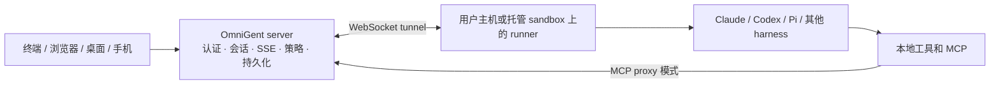

# OmniGent 源码调研与 ScanSci 借鉴清单

> 调研日期：2026-09-30。上游固定在 [`74f94c3d55ae38623fc01c21ad2ea1823dbe8828`](https://github.com/omnigent-ai/omnigent/commit/74f94c3d55ae38623fc01c21ad2ea1823dbe8828)（`pyproject.toml` 标为 `0.17.0.dev0`）。本报告依据该提交的 README、设计文档、源码和测试说明作静态分析，未启动 OmniGent 服务或真实模型。以下建议不改变 ScanSci v0.4.2 的 P0、Pi/Host 权责或发布门禁。

## 结论

OmniGent 的主线是把多种现成 coding-agent harness 接到共同的会话、策略、协作和远程运行界面。它把“能力声明”“可观测的行为”“用户入口”分别维护，再用测试把三者关联起来。这种证据组织方法最值得 ScanSci 学习。ScanSci 已经拥有 [10 轴 Pi 发布矩阵](agent-harness-p0-p2.zh.md)、Host 租约和证据权威、直接对话的持久化队列，因此近期收益来自补足**用户入口到验收证据的映射**、**模型/transport 维度的实测覆盖**和**断线恢复的可检查契约**。

OmniGent 的多 harness、共享云服务、多人共驾和 Python 扩展体系服务于另一种产品范围；将其直接搬进 ScanSci 会增加权限面和 Windows 运行时负担。其 Windows Job Object 后端明确只约束进程树与资源，文件系统及网络规则在该后端属于 advisory 配置。ScanSci 的 Windows 桌面端不能把这一层当作文件或网络隔离依据。[上游自述](https://github.com/omnigent-ai/omnigent/blob/74f94c3d55ae38623fc01c21ad2ea1823dbe8828/README.md) · [Windows 后端](https://github.com/omnigent-ai/omnigent/blob/74f94c3d55ae38623fc01c21ad2ea1823dbe8828/omnigent/inner/windows_jobobject_sandbox.py)

## 上游运行路径

部署文档说明 server 负责 HTTP/SSE、持久化、UI 和隧道，runner 在连接的主机上执行 harness 与工具；server 镜像无需打包各 harness SDK 和模型密钥。代理可在用户主机或托管 sandbox 运行。server/runner 描述部署拓扑；ScanSci 的 Pi/Host 描述编排和授权权责。ScanSci 保持 Pi 作为能力轮次唯一编排面、Host 作为不可转让的授权与证据面。[部署模型](https://github.com/omnigent-ai/omnigent/blob/74f94c3d55ae38623fc01c21ad2ea1823dbe8828/deploy/README.md#execution-model) · [ScanSci 现行契约](research-agent-architecture.zh.md)

## 逐项学习

| 主题 | OmniGent 的具体做法及证据 | ScanSci 当前基础与可借鉴点 |
| --- | --- | --- |
| 能力声明与实测 | [`HarnessCapabilities`](https://github.com/omnigent-ai/omnigent/blob/74f94c3d55ae38623fc01c21ad2ea1823dbe8828/omnigent/harness_capabilities.py) 把集成方式、审批、恢复、流式、打断、图片等能力声明成统一结构；[registry](https://github.com/omnigent-ai/omnigent/blob/74f94c3d55ae38623fc01c21ad2ea1823dbe8828/omnigent/harness_plugins.py) 汇集内置和社区 harness。未声明的可选能力为 `UNKNOWN`。[harness bench](https://github.com/omnigent-ai/omnigent/blob/74f94c3d55ae38623fc01c21ad2ea1823dbe8828/tests/harness_bench/README.md) 把声明与真实探针比较，分别报告覆盖率和漂移。默认退出码 0 只表示未发现漂移；`--live --require-complete` 才要求所选维度有结论。 | ScanSci 的 10 轴发布矩阵已有 deterministic 与 provider-real 证据、`not_run` 和哈希绑定。可在现有报告旁建立“provider × model × transport × feature”的窄范围实测表；保留原 10 轴为唯一发布门禁。 |
| 用户功能地图 | [`feature-map/README.md`](https://github.com/omnigent-ai/omnigent/blob/74f94c3d55ae38623fc01c21ad2ea1823dbe8828/feature-map/README.md) 从用户视角记录每个入口、状态、测试和陷阱；CI 检查引用的测试、功能文件格式及未映射的 UI 区域/CLI 命令，用户入口变更还有非阻塞审查提示。修复需证明列出的每个入口，或注明不适用。 | ScanSci 的代码、发布验收项和 UI 测试已经存在，但缺少同一份轻量入口索引。先覆盖直接对话、Agent 模式、PDF 导入、运行时/应用更新四个高频功能。每项只链接既有定向测试和可见状态。 |
| 会话持久化与实时流 | [`session_stream.py`](https://github.com/omnigent-ai/omnigent/blob/74f94c3d55ae38623fc01c21ad2ea1823dbe8828/omnigent/runtime/session_stream.py) 使用每订阅者有界临时队列；早于订阅的事件不重放，溢出后断开。客户端重连读取持久化快照，再按 item ID 去重接续 live tail。[数据库 append](https://github.com/omnigent-ai/omnigent/blob/74f94c3d55ae38623fc01c21ad2ea1823dbe8828/omnigent/stores/conversation_store/sqlalchemy_store.py) 用稳定 ID 去重、事务内单调 position；fork 为复制项生成新身份并剔除源会话绑定。 | [`direct_chat_history.py`](../src/scansci_html/direct_chat_history.py) 已保存稳定消息 ID、队列、revision、事件序号及分支。值得定向检查浏览器断线/重启时的快照、晚到结果和队列重放，特别是 UI 是否用相同 ID 收敛；不需要替换当前 Host 存储。 |
| 队列与运行中调整 | [Queue + steer 设计](https://github.com/omnigent-ai/omnigent/blob/74f94c3d55ae38623fc01c21ad2ea1823dbe8828/docs/QUEUE_STEER_DESIGN.md) 区分尚未 POST 的可编辑草稿、已提交消息、当前轮次 steer 和真正中断；未发草稿存在 `localStorage`，因此不跨设备同步。[Composer 功能地图](https://github.com/omnigent-ai/omnigent/blob/74f94c3d55ae38623fc01c21ad2ea1823dbe8828/feature-map/composer.md) 给出队列/steer 的现有 E2E 用例；设计文档对部分原生 harness 的实时生效仍标为未实测。 | ScanSci 已有 Host 持久化队列与编辑重做。可借鉴草稿/已提交/执行中的 UI 状态词和真实 steer 能力标识，不迁移到仅浏览器持有的队列。 |
| 策略与审批 | [策略文档](https://github.com/omnigent-ai/omnigent/blob/74f94c3d55ae38623fc01c21ad2ea1823dbe8828/docs/POLICIES.md) 提供 session、agent、server 三层 `ALLOW/DENY/ASK`；[`engine.py`](https://github.com/omnigent-ai/omnigent/blob/74f94c3d55ae38623fc01c21ad2ea1823dbe8828/omnigent/runtime/policies/engine.py) 顺序计算并在 DENY 时短路，ASK 的状态写入等待批准。[approval.py](https://github.com/omnigent-ai/omnigent/blob/74f94c3d55ae38623fc01c21ad2ea1823dbe8828/omnigent/runtime/policies/approval.py) 对取消、超时和无效答复拒绝。MCP proxy 在 server 侧执行调用前后策略，并校验用户填写的 elicitation schema。 | ScanSci 已有 TaskContract v2、capability lease、逐次 effect 授权和审计。可把每次工具裁决展示为“请求 ID、租约版本、effect、规则、ALLOW/ASK/DENY、批准结果”的有界诊断视图；底层权威继续归 Host。外部 MCP 的回答内容也应在信任边界校验。[MCP proxy](https://github.com/omnigent-ai/omnigent/blob/74f94c3d55ae38623fc01c21ad2ea1823dbe8828/omnigent/runner/proxy_mcp_manager.py) |
| 预算与死循环 | [`safety.py`](https://github.com/omnigent-ai/omnigent/blob/74f94c3d55ae38623fc01c21ad2ea1823dbe8828/omnigent/policies/builtins/safety.py) 有会话工具次数上限和 `(tool, arguments)` 滑动窗口重复检测；后者重复达到阈值时 ASK。[`cost.py`](https://github.com/omnigent-ai/omnigent/blob/74f94c3d55ae38623fc01c21ad2ea1823dbe8828/omnigent/policies/builtins/cost.py) 在请求与工具调用前检查累计美元成本，未定价但已有 token 用量时 ASK；单轮成本可能超出上限。 | ScanSci 已有工具、恢复与模型 token 预算。可先用现有 run/effect 事件分析真实重复调用，再决定是否引入按工具语义区分的循环提醒；科研检索的相同参数重试可能合理。美元预算要先解决各 provider 价格与结算口径，不纳入当前 P0。 |
| 扩展与 Skill | [浏览器扩展](https://github.com/omnigent-ai/omnigent/blob/74f94c3d55ae38623fc01c21ad2ea1823dbe8828/docs/extending/browser_extensions.md) 在 opaque-origin iframe、CSP 和受限 `MessagePort` 下运行，方法按权限开放；[扩展文档](https://github.com/omnigent-ai/omnigent/blob/74f94c3d55ae38623fc01c21ad2ea1823dbe8828/docs/extending/extensions.md) 明确安装 Python 扩展需信任其完整代码。`load_skill` 延迟加载内容与资源列表。 | ScanSci 已有 Skill 的路径、哈希、字节与租约边界，以及 Electron 外部页面隔离设计。借鉴可用于未来插件 UI 审查；当前非目标仍是不授予第三方 extension 权限。[现行治理](project-governance.zh.md) |
| 计划任务 | [Automations](https://github.com/omnigent-ai/omnigent/blob/74f94c3d55ae38623fc01c21ad2ea1823dbe8828/docs/AUTOMATIONS.md) 每次触发创建真实 session、绑定 owner、附单次预算并记录 run；触发前重读任务行。停机期间错过的触发不补跑，失败不自动重试，重叠或晚到触发跳过。 | 若 ScanSci 日后加入持续文献监测，需先明确 owner、租约、离线与补跑语义，再做 UI。此项留在后续产品设计，不挤占 v0.4.2 更新与 Pi 门禁。 |
| 诊断与隐私 | [`session_stream.py`](https://github.com/omnigent-ai/omnigent/blob/74f94c3d55ae38623fc01c21ad2ea1823dbe8828/omnigent/runtime/session_stream.py) 只把闭集标识与数值写入普通 SSE 审计；[原生 harness 诊断](https://github.com/omnigent-ai/omnigent/blob/74f94c3d55ae38623fc01c21ad2ea1823dbe8828/docs/harness-diagnostics.md) 须显式开启，采用有界缓冲，并说明正则脱敏无法保证清除自由文本中的秘密。 | ScanSci 已在 run manifest 限制提示、图像和大结果。借鉴其“普通审计白名单、详细诊断显式开启、输出大小上限”的分层说明，并对调试导出做真实内容审查。 |

### 上游证据的适用边界

- Harness bench 的 mock provider 只证明执行链路；真实模型行为受模型、CLI 版本、登录和时序影响。它有 `SKIPPED`、`UNKNOWN`、`PARTIAL` 和传输不可观测项，不能把矩阵中的声明行视作实测通过。[测试说明](https://github.com/omnigent-ai/omnigent/blob/74f94c3d55ae38623fc01c21ad2ea1823dbe8828/tests/harness_bench/README.md)
- `feature-map` 明列策略/成本、MCP、sandbox provider、智能路由等区域尚无 UI 测试 lane。它是持续维护的索引，并非全产品已验收声明。[功能地图](https://github.com/omnigent-ai/omnigent/blob/74f94c3d55ae38623fc01c21ad2ea1823dbe8828/feature-map/README.md)
- `cost.py` 文件顶部仍写“默认超额降级、未定价 DENY”，当前 `_resolve_expensive_models` 与 `cost_budget` 实际将空 `expensive_models` 解释为全部模型硬停，并对有 token 但未定价成本的请求返回 ASK。此处应以当前函数与相应测试为准，显示了为何需要把文档主张和源码行为对照。[当前源码](https://github.com/omnigent-ai/omnigent/blob/74f94c3d55ae38623fc01c21ad2ea1823dbe8828/omnigent/policies/builtins/cost.py)
- OmniGent 的 Windows 进程容器没有实现 read/write roots 或 network isolation。它的共享 server、托管 sandbox、多 harness 和 operator-installed Python 扩展会扩大部署与信任面，均需独立设计和威胁分析。[Windows 后端](https://github.com/omnigent-ai/omnigent/blob/74f94c3d55ae38623fc01c21ad2ea1823dbe8828/omnigent/inner/windows_jobobject_sandbox.py) · [扩展信任](https://github.com/omnigent-ai/omnigent/blob/74f94c3d55ae38623fc01c21ad2ea1823dbe8828/docs/extending/extensions.md)

## ScanSci 能力覆盖审计（2026-10-01）

对照 OmniGent 的“声明/观测/缺测”做法，读取了 ScanSci 当前 [10 轴任务矩阵](../bench/pi_capability_tasks.json)、[验证器](../scripts/verify_pi_capabilities.py)、[报告 schema](../config/release-report.schema.json)和本机已有的历史报告。本节只审计记录结构与已有结果，没有启动 Pi、真实 provider 或发布门禁，也没有重新计算源码、matrix、bundle 哈希。

| 证据层 | 当前可确认的事实 | 对覆盖解释的影响 |
| --- | --- | --- |
| 能力声明 | 10 轴矩阵要求 `dynamic_tools` 与 `multimodal` 两轴有 provider-real runtime 证明；其他轴来自既定 JUnit 批次。 | 发布矩阵明确了每轴的证据来源，不能把十轴都描述成同一真实模型的实测行为。 |
| 真实 provider 探针 | `verify_pi_capabilities.py` 一次从环境变量读取一组 `provider/provider_kind/base_url/model/api_surface` 与凭据，执行 10 次动态工具激活和 10 次图像加工具任务。 | 一份 real 报告代表一个所选组合；它不说明其他模型或传输也通过。 |
| 报告身份 | report schema v2 顶层保存 protocol、SDK、源码/bundle/matrix 哈希、`provider_id`、10 轴和 manifest 引用；顶层 provider 记录没有 `model_id`、`provider_kind` 或 `api_surface`。 | 现有发布报告具备版本绑定和单 provider 身份，尚不能直接作为“provider × model × transport”覆盖表。单个 manifest 的细节不能替代汇总身份。 |
| 历史记录 | 本地历史报告曾分别记录 real 探针超时、通过和 `not_run: provider_not_configured`，另一次 deterministic 探针因 `BrokenPipeError` 失败。报告不随源码仓库发布。 | 这些结果对应不同时间、源码与 SDK。当前改动中的工作树没有新的通过证据，不能沿用旧的 `passed` 状态。 |

**下一步的最小设计：**先在发布门禁之外记录一张只读覆盖表，每行固定 provider ID、provider kind、模型 ID、API surface、SDK/protocol、声明的工具/图像能力、实际观测状态、`not_run` 原因及原报告路径。只引用现有报告和 manifest，不写入 base URL 或凭据，不更改 10 轴的通过条件。选两组实际可用的组合执行前，先确认各自声明支持工具和图像；缺少真实 provider 时保留 `not_run`。历史 `BrokenPipeError` 对应的日志为空；后续定向执行一次真实 sidecar 工具循环及两轮动态工具/图像工具循环均通过，尚未复现该错误，也未重跑完整 deterministic 门禁。

## 建议的 ScanSci 落地顺序

| 批次 | 范围与验收 | 风险 / 最小验证 / 审查 |
| --- | --- | --- |
| 1. 功能入口地图 | 已建立 [首批用户功能地图](user-feature-map.zh.md)：四个用户功能条目含入口、状态、现有测试、人工复核和未覆盖入口。后续改动按此图维护。 | 低风险；文档链接检查即可；实现者自检。 |
| 2. 能力实测切片 | 已完成上方的结构与历史记录审计。下一步选择两个实际可用的 provider/model/transport 组合，记录声明、真实观测、`not_run` 原因和版本；缺凭据不能显示通过。 | 中风险，触及报告解释；批次末综合审查；先用定向 report/schema 测试。真实 provider 运行需要具备凭据。 |
| 3. 会话恢复与策略可见性 | 已完成[链路审计与定向修补](omnigent-session-policy-audit.zh.md)：浏览器流式 POST、科研续问和同步聊天/问答均以提交键在 Host 持久占位；续问的同问题重试沿用原请求体；暂停续跑先查询原请求状态，删除对话清理终态。内置工具授权输出有界裁决事件、拒绝重复调用 ID，并用 `call_ref` 关联结果；非幂等内置工具或 MCP effect 启动后停止兼容回退。内置非只读工具按用户轮次、工具名与参数持久占位，覆盖同轮自动恢复、输出修复及持久 `ask` 阶段重试。真实浏览器断线、provider 和直连 MCP 的持久去重待验证。 | 中到高风险，跨会话与权限边界；权限和提交契约分别完成专项审查。 |
| 4. 未来产品探索 | 美元成本上限、科研任务计划触发、跨设备协作、第三方插件 UI 各自独立评估；先写信任边界、真实需求和验收口径。 | 影响产品范围与权限，暂不进入当前 P0。 |

本调研报告保持源码学习结论；后续落地进度以各自文档为准。当前未修改 `config/release-scope.json` 或协议；第三批将提交表定向测试纳入发布门禁。按 [项目启动流程](agent-startup.zh.md) 和 [发布流程](release-workflow.zh.md) 实施时，先固定具体范围与证据；全量测试仍需当前任务的用户明确授权。
